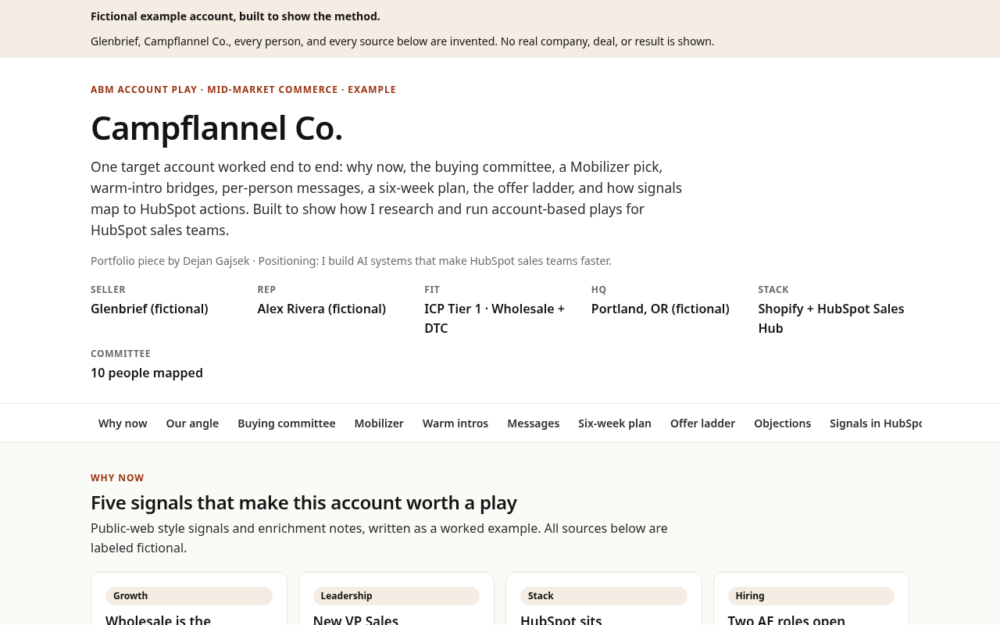

# ABM account intel

I built this to show how I run account-based plays for HubSpot sales teams.

Spray-and-pray volume is easy. What hiring managers and revenue teams actually want is one account worked properly: why now, who decides, who can introduce you, what to say to each person, and how you track it in HubSpot without burning the brand.

This repo has two parts:

1. A **portfolio demo** (`demo/index.html`) of a full account play
2. A **reusable skill** (`skill/`) you can drop into Claude Code or a Claude Project to generate the next play

Positioning: I build AI systems that make HubSpot sales teams faster.

## Fictional demo

`demo/index.html` uses invented companies and people on purpose:

| Role | Name |
| --- | --- |
| Seller (B2B SaaS) | Glenbrief |
| Target (mid-market outdoor apparel, DTC + wholesale) | Campflannel Co. |
| Sending rep | Alex Rivera |

Every source on the demo page is labeled fictional. Do not treat any number or outcome there as a case study.

Open the demo:

```bash
open demo/index.html
# or serve it
python3 -m http.server 8765 --directory demo
```



## How to use the skill

### Claude Code

```bash
# from this repo, or copy skill/ into your Claude skills folder
claude
# then ask:
# Use the abm-account-intel skill. Target: <company>. Offer: <one sentence>. Seller: <company>. Rep: <name>.
```

### Claude Projects

1. Create a Project
2. Upload `skill/SKILL.md` plus both files in `skill/templates/`
3. In the Project instructions, say: follow `SKILL.md` for any account play request
4. Prompt with the target account, offer, seller, and rep name

The skill asks for public-web research, an enrichment tool of your choice, HubSpot (or your CRM), and a Sales Navigator pass by the rep for warm bridges. It does not invent mutual connections or client results.

## Repo layout

```
abm-account-intel/
├── README.md
├── LICENSE
├── demo/
│   ├── index.html      # portfolio piece
│   └── preview.png     # screenshot
└── skill/
    ├── SKILL.md
    └── templates/
        ├── account-play.html
        └── account-brief.md
```

## Author

Dejan Gajsek · [github.com/dejan-gajsek](https://github.com/dejan-gajsek)

MIT licensed. Push to GitHub only when you are ready; this repo ships as a local commit first.
